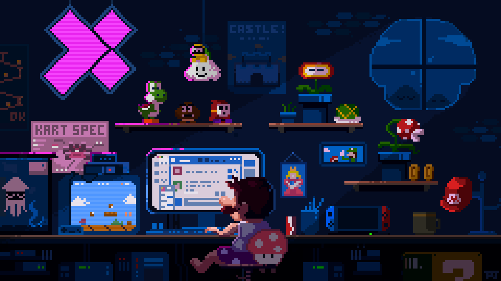

<!-- generated by scripts/build.py from profile.json -->

<h3><code>~/shreeram $ ./contributions.sh</code></h3>

  

<h3><code>~/shreeram $ whoami</code></h3>

<table>
  <tr>
    <td valign="top"></td>
    <td valign="top"></td>
  </tr>
</table>

 

<h3><code>~/shreeram $ ./snake --eat contributions</code></h3>

<picture>
  <source media="(prefers-color-scheme: dark)" srcset="https://raw.githubusercontent.com/shreeram2011/shreeram2011/output/github-snake-dark.svg"/>
  <source media="(prefers-color-scheme: light)" srcset="https://raw.githubusercontent.com/shreeram2011/shreeram2011/output/github-snake.svg"/>
  
</picture>

  

<h3><code>~/shreeram $ ./links.sh</code></h3>

<b>MCA Student · Full Stack Developer · DSA Enthusiast</b>

 

Profile template by <a href="https://github.com/GubreleySanskar">@GubreleySanskar</a>

---

  

###

  <!-- LinkedIn Badge with hyperlink -->
  
  
  <!-- Gmail Badge with hyperlink -->
  

###

  

###

<h1 align="center">hey there 👋</h1>

###

<h3 align="left">👋 Hi, I'm Shreeram Yadav!</h3>

###

📚 About Me:  🎓MCA student at Vivekanand Education Society Institute of Technology (VESIT). 💻 Strong expertise in full-stack development, specializing in the MERN stack. 🌐 Passionate about solving real-world problems with scalable and efficient solutions. 🌱 Always eager to explore new technologies across different fields. 🚀 Committed to continuous learning and building innovative projects.

###

<h3 align="left">🛠 Language and tools</h3>

###

  
  
  
  
  
  
  
  
  
  
  
  
  
  
  
  
  

###

<h3 align="left">🔥 My Stats :</h3>

###

  

### Let's Connect 🤝:
Feel free to reach out if you want to collaborate on exciting projects 💡 or discuss the latest trends in **AI** 🤖, **DevOps** ⚙️, or **web development** 🌐. Let’s make something amazing together! 🚀

###
